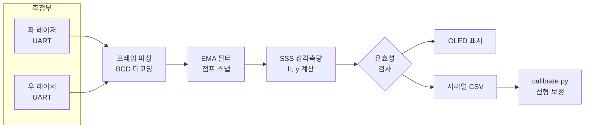

# KORAIL 연결기 높이 측정기

> 레이저 거리센서 2개와 궤간(1435 mm)만으로 철도차량 연결기 높이를 재는 휴대형 측정 장치


## 개요

철도차량 연결기는 레일면 기준 정해진 높이(약 880 mm)를 유지해야 하며, 정비 현장에서는 이를 자나 게이지로 직접 재는 경우가 많습니다.
이 프로젝트는 연결기에 장치를 대고 **두 레이저가 좌·우 레일을 찍은 거리만으로** 높이를 계산해 즉시 보여주는 측정기를 만드는 것을 목표로 합니다.

## 주요 기능

- **각도 없는 삼각측량**: 밑변(궤간) + 두 측정 거리(SSS)로 높이 계산 → 레이저 각도를 손으로 바꿔도 재보정 불필요
- **비대칭 자동 처리**: 장치가 좌우로 치우쳐 두 거리가 달라도 수직 높이를 정확히 계산, 치우침(y)도 표시
- **측정 신뢰도 표시**: 레이저별 실시간/과거 데이터/반사 없음 상태, 높이의 LIVE/HOLD 상태를 OLED에 표시
- **이상 측정 차단**: 삼각형이 성립하지 않는 값(레이저가 레일을 벗어남 등)은 높이를 내지 않음
- **센서 자동 복구**: 응답 없는 센서를 하나씩 시간차로 재시작
- **보정 도구**: 시리얼 CSV 로깅 + 최소제곱 선형 보정 스크립트

## 측정 원리

```
             O  회전축(꼭짓점)
            /|\
         a / | \ b          x = (a² − b² + D²) / 2D
          /  |h \           h = √(a² − x²)
   좌 A ●────F────● B 우
        |<--- D = 1435 --->|
```

두 레이저는 같은 회전축에서 X자로 돌아가며 레일 두정면을 겨눕니다. 세 변이 정해지면 삼각형이 하나로 정해지므로 각도는 필요하지 않습니다.

→ 유도, 오차 분석, 각도 기반 방식과 비교: [docs/measurement-principle.md](docs/measurement-principle.md)

## 시스템 구성



| 구분 | 내용 |
|---|---|
| MCU | ESP32 (Arduino) |
| 센서 | UART 레이저 거리센서 ×2 (9600 bps) |
| 디스플레이 | SSD1309 128×64 OLED (I2C, U8g2) |
| 도구 | Python 3 (보정, 로깅) |

→ 부품 목록, 배선, 통신 프로토콜: [docs/hardware.md](docs/hardware.md)

## 화면

```
┌────────────────────────────┐
│ L 1155 ●   │  R 1156 ●     │  ← 레이저 거리 + 상태
├────────────────────────────┤
│          905.9 mm          │  ← 연결기 높이
│ LIVE                  y+0  │  ← 데이터 상태 | 좌우 치우침
└────────────────────────────┘
```

| 표시 | 의미 |
|---|---|
| `●` | 해당 레이저 실시간 측정 중 |
| `1.2s` (반전) | 측정이 끊겨 1.2초 전 값 표시 중 |
| `EE` (반전) | 반사 신호 없음 |
| `LIVE` / `HOLD 1.2s` | 높이가 실시간 값 / 과거 데이터 기반 |
| `TRI NG` (반전) | 삼각형 불성립 → 높이 `----` |

## 시작하기

1. Arduino IDE에 ESP32 보드 패키지와 **U8g2** 라이브러리 설치
2. `firmware/coupler_height/coupler_height.ino` 열기
3. 보드: ESP32 Dev Module 선택 후 업로드
4. 시리얼 모니터 115200 bps에서 CSV 로그 확인: `ms,L_mm,R_mm,h_mm,y_mm,live`

## 보정

```bash
python3 tools/calibrate.py points.csv   # 표시값 vs 실측값 → H_GAIN, H_OFFSET_MM
```

→ 거리 0점 / 높이 선형 보정 절차: [docs/calibration.md](docs/calibration.md)

## 개발 과정에서 해결한 문제

| 문제 | 원인 | 해결 |
|---|---|---|
| 각도 1° 오차에 높이 약 13 mm 오차 | 초기안은 고정 장착각 θ 를 식에 사용 | 궤간을 밑변으로 쓰는 SSS 방식으로 바꿔 각도를 식에서 제거 |
| 장치가 치우치면 높이 계산 불가 | 대칭(이등변) 가정 | 수선의 발 위치 x 를 구하는 일반 삼각형 식 적용 |
| 측정이 멈춰도 옛 값이 그대로 보임 | 마지막 값만 표시 | 레이저별 마지막 갱신 시각을 추적해 실시간/과거/실패를 구분 표시 |
| 가끔 한쪽 레이저가 켜지지 않음 | 동시 기동 시 순간 전류, 부팅 전 명령 수신 | 부팅 대기 + 시간차 시작, 무응답 센서 개별 재시작 |
| 낮은 높이에서 측정 불가 | 센서 0점과 회전축 불일치로 a + b < D | 0점 오프셋 보정 항 추가 |

## 저장소 구조

```
├── firmware/
│   └── coupler_height/
│       └── coupler_height.ino   # ESP32 펌웨어
├── tools/
│   ├── calibrate.py             # 선형 보정값 계산
│   └── log_serial.py            # 시리얼 CSV 로깅
└── docs/
    ├── measurement-principle.md # 측정 원리 · 오차 분석
    ├── hardware.md              # 부품 · 배선 · 프로토콜
    └── calibration.md           # 보정 절차
```

## 향후 개선

- 측정값 평균/홀드 버튼 (현장 기록용)
- 블루투스로 측정 기록 전송
- 착점이 레일 두정면 위에 있는지 판별하는 정렬 가이드
