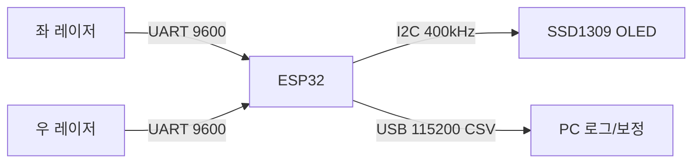

# 하드웨어

## 구성품

| 부품 | 사양 | 수량 |
|---|---|---|
| MCU | ESP32 개발보드 | 1 |
| 레이저 거리센서 | UART(TTL) 9600 bps, 연속 측정 명령 지원 | 2 |
| OLED | SSD1309 128×64, I2C | 1 |
| 회전 마운트 | 두 센서를 같은 축에 X자로 고정 | 1 |
| 전원 | 두 센서 동시 구동 가능한 용량 | 1 |

## 배선

| 장치 | 신호 | ESP32 핀 |
|---|---|---|
| 좌 레이저 (L) | 센서 TX → | GPIO 25 (Serial1 RX) |
| | 센서 RX ← | GPIO 26 (Serial1 TX) |
| 우 레이저 (R) | 센서 TX → | GPIO 16 (Serial2 RX) |
| | 센서 RX ← | GPIO 17 (Serial2 TX) |
| OLED | SDA | GPIO 21 |
| | SCL | GPIO 22 |

모든 장치의 GND 는 공통으로 묶습니다.

## 센서 통신

- 연속 측정 시작 명령: `AA 00 00 21 00 01 00 00 22`
- 응답 프레임 12바이트, 헤더 `0xAA` 로 동기화
- 거리: 6~9번 바이트 BCD → `DIST_SCALE` 배율 적용 (mm)
- 6번 바이트가 `0xEE` 이면 반사 없음(측정 실패)

## 전원 관련 주의

두 레이저가 동시에 켜질 때 순간 전류로 한쪽이 켜지지 않는 현상이 있어, 펌웨어에서 시간차 시작과 개별 재시작을 합니다.
그래도 반복되면 센서 전원단에 100~470 µF 콘덴서를 추가하고 공급 전류를 확인합니다.
