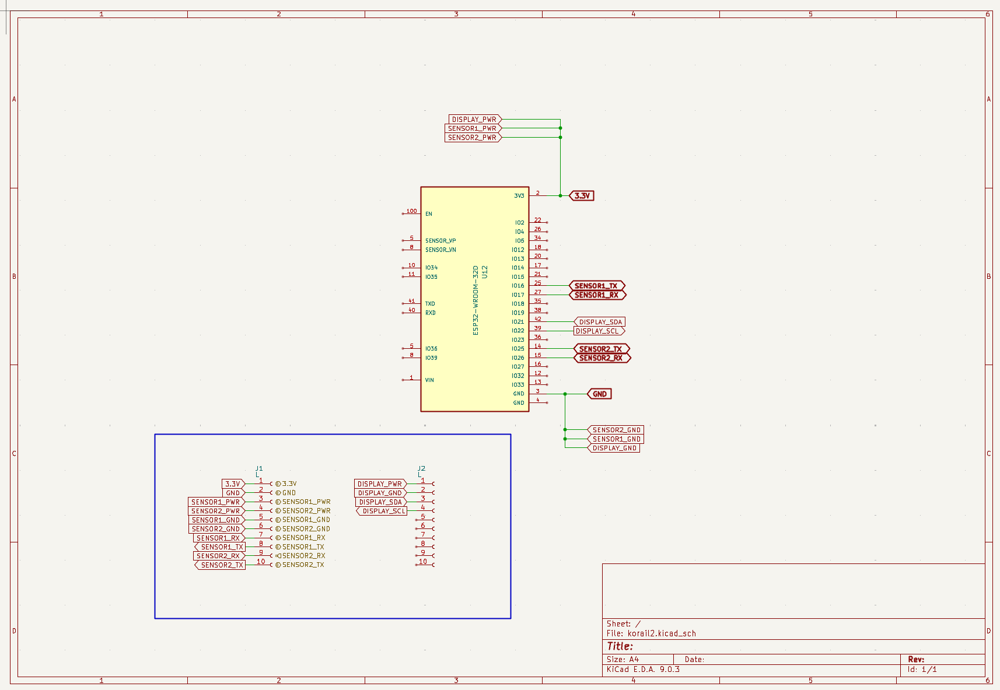
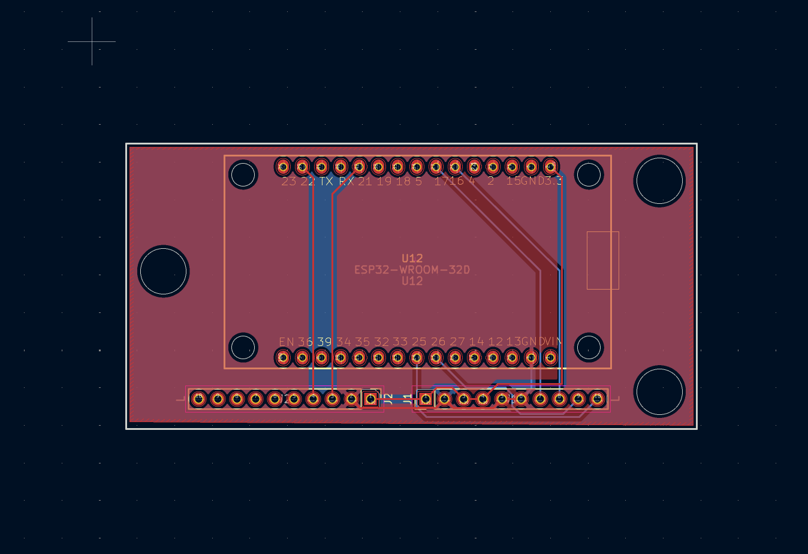
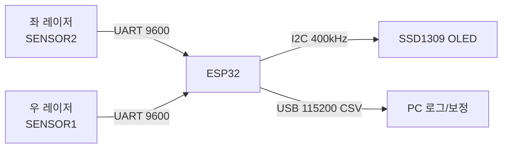
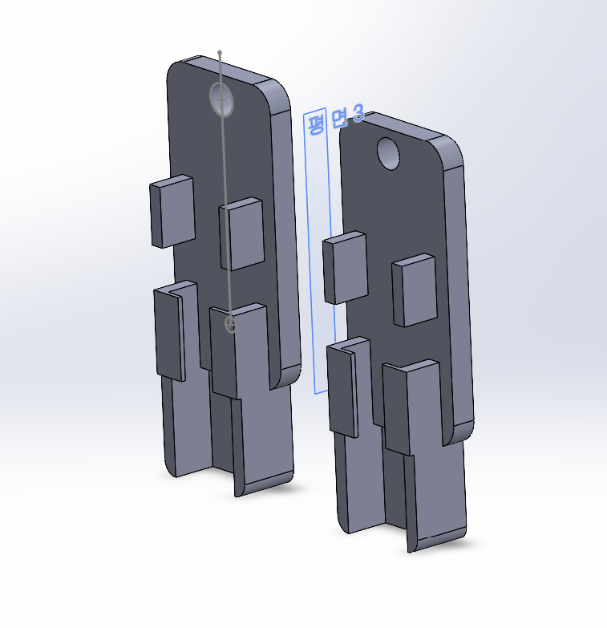
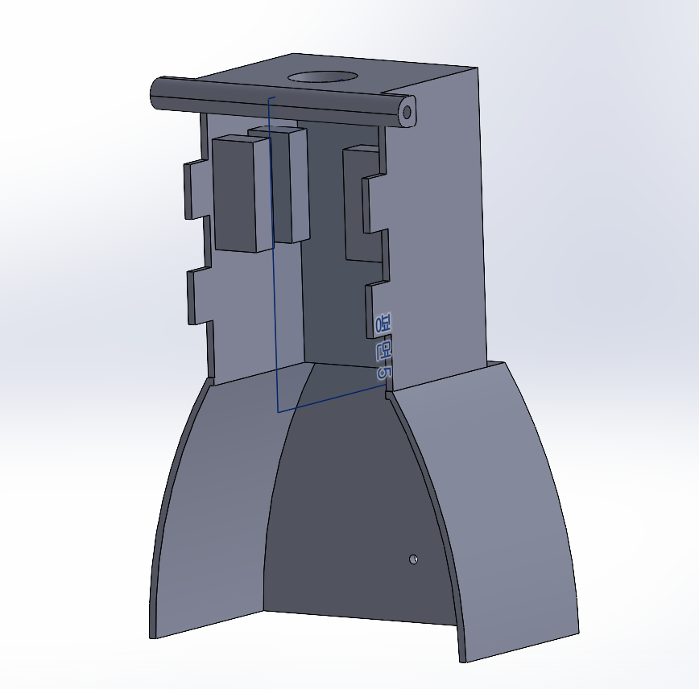
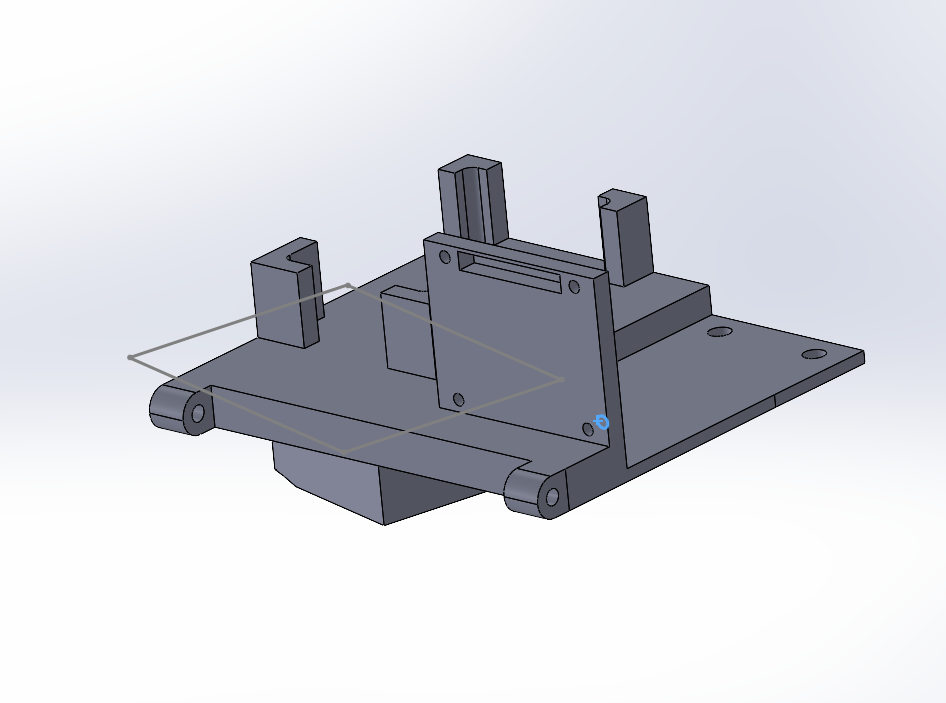
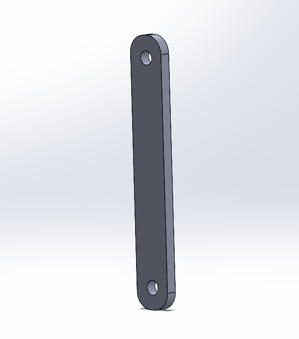

# 하드웨어

## 부품 목록 (BOM)

| 부품 | 사양 | 수량 | 용도 |
|---|---|---|---|
| 레이저 거리센서 | JRT C5B / RX 계열 M01 50M 모듈 (위상차, ±1 mm, UART TTL 3.3V) | 2 | 좌/우 거리 측정 |
| MCU | ESP32 DevKitC V4 (ESP32-32E 모듈) | 1 | 수신 · 계산 · 표시 |
| 디스플레이 | 1.54" OLED 128×64, SSD1309, I2C | 1 | 측정값 표시 |
| 광학 필터 | 650 nm 대역 통과 필터 | 1 | 야외 햇빛 오측정 방지 |
| PCB | 자체 설계 2층 보드 (KiCad 9) | 1 | ESP32 · 센서 · OLED 연결 |
| 기구부 | 자체 설계 (SolidWorks) | 1식 | 장치 기구부 |

센서 비교와 선정 과정: [sensor-selection.md](sensor-selection.md)

## 회로도

KiCad 원본: [hardware/pcb/korail2.kicad_sch](../hardware/pcb/korail2.kicad_sch)

- ESP32 DevKit을 헤더로 꽂는 캐리어 보드 구조
- ESP32 3V3 출력으로 센서 2개와 OLED에 전원 공급, GND 공통
- **J1 (10핀)**: 센서 커넥터 — 3.3V, GND, SENSOR1/2 PWR, SENSOR1/2 GND, SENSOR1 RX/TX, SENSOR2 RX/TX
- **J2 (10핀)**: 디스플레이 커넥터 — PWR, GND, SDA, SCL

## PCB

- 2층 기판, 상단에 ESP32 DevKit 소켓, 하단에 J1 / J2 헤더 배치
- 기판 모서리에 고정용 마운팅 홀
- 신호선은 ESP32 핀에서 J1 / J2로 최단 경로 배선

## 핀 배정

| 넷 | ESP32 핀 | 펌웨어 |
|---|---|---|
| SENSOR1_TX → ESP RX | GPIO 16 | Serial2 RX, 우(R) 레이저 |
| SENSOR1_RX ← ESP TX | GPIO 17 | Serial2 TX |
| SENSOR2_TX → ESP RX | GPIO 25 | Serial1 RX, 좌(L) 레이저 |
| SENSOR2_RX ← ESP TX | GPIO 26 | Serial1 TX |
| DISPLAY_SDA | GPIO 21 | I2C SDA |
| DISPLAY_SCL | GPIO 22 | I2C SCL |

> 회로도의 SENSOR1/2 번호와 실제 장착 위치는 펌웨어에서 매핑합니다 (SENSOR2 = 좌, SENSOR1 = 우).

## 센서 통신

- 연속 측정 시작 명령: `AA 00 00 21 00 01 00 00 22`
- 응답 프레임 12바이트, 헤더 `0xAA`로 동기화
- 거리: 6~9번 바이트 BCD → `DIST_SCALE` 배율 적용 (mm)
- 6번 바이트가 `0xEE`이면 반사 없음 (측정 실패)

## 전원 관련 주의

두 레이저가 동시에 켜질 때 순간 전류로 한쪽이 켜지지 않는 현상이 있어, 펌웨어에서 시간차 시작과 개별 재시작을 합니다.
그래도 반복되면 센서 전원단에 100~470 µF 콘덴서를 추가하고 공급 전류를 확인합니다.

## 기구 설계

| 센서 홀더 (좌/우 한 쌍) | 하우징 |
|---|---|
|  |  |
| **베이스 (PCB · 디스플레이 장착)** | **링크** |
|  |  |

SolidWorks 부품 파일: [hardware/mechanical](../hardware/mechanical)
