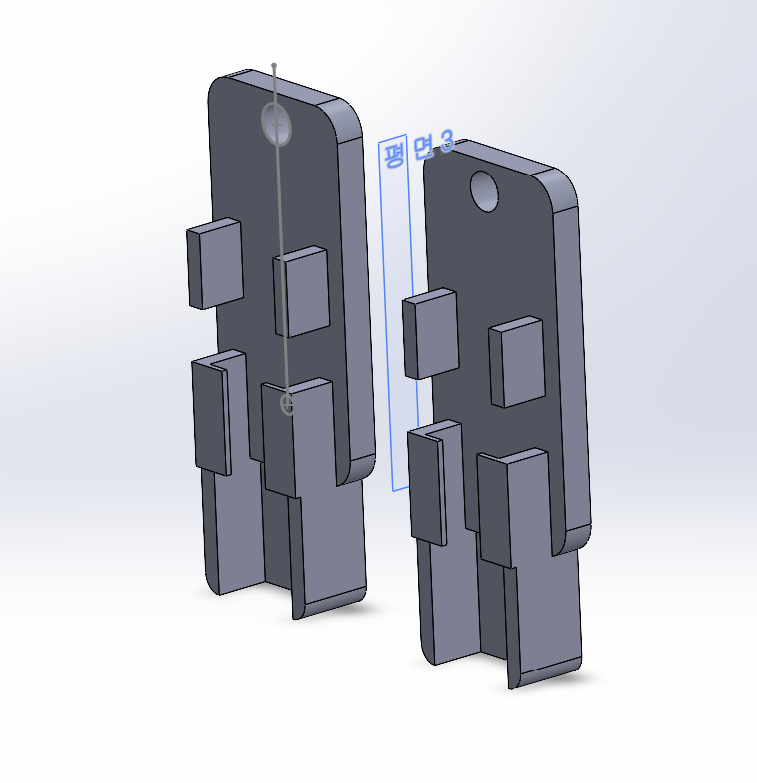
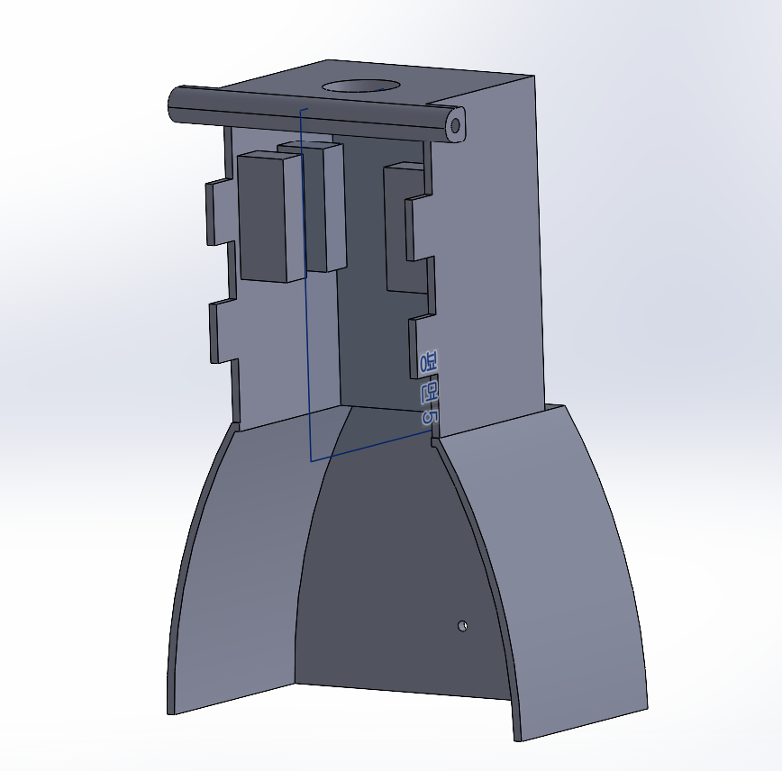
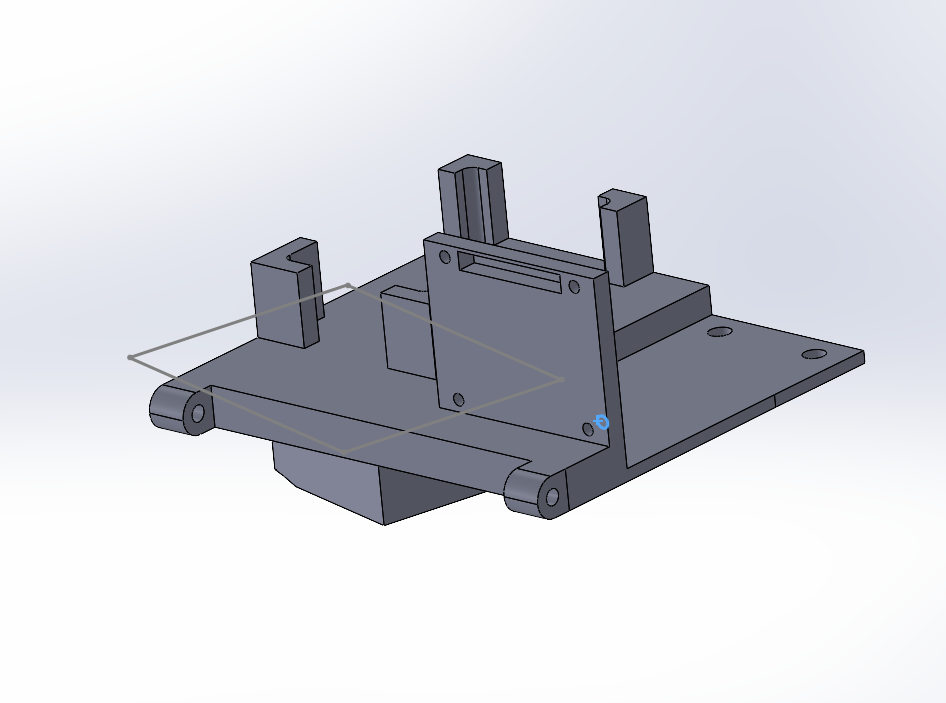
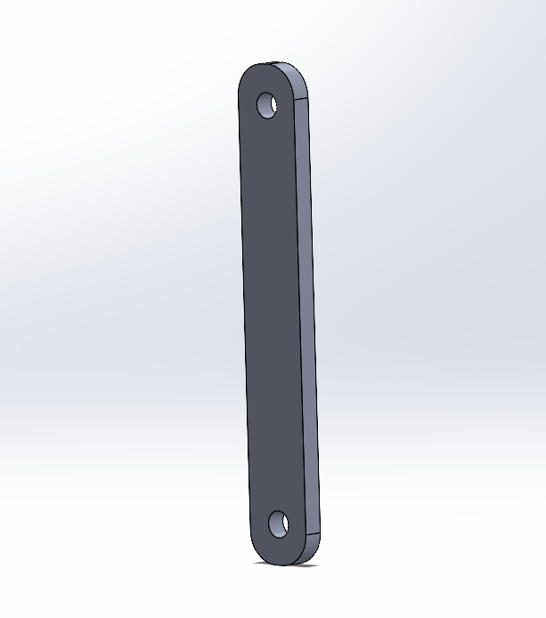

# 기구 설계 (SolidWorks)

| 파일 | 설명 |
|---|---|
| `AAR_E_ver3.SLDPRT` | AAR E형 관련 부품 (ver.3) |
| `part_1.SLDPRT` | (설명 추가 필요) |
| `part_2.SLDPRT` | (설명 추가 필요) |
| `part_3.SLDPRT` | (설명 추가 필요) |

| 센서 홀더 (좌/우 한 쌍) | 하우징 |
|---|---|
|  |  |
| **베이스 (PCB · 디스플레이 장착)** | **링크** |
|  |  |

SolidWorks로 열 수 있습니다.
